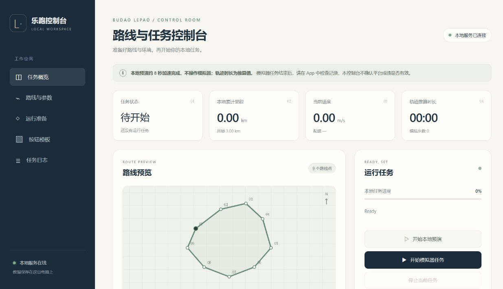

# budaolepao
步道乐跑 刷跑脚本 + 反作弊检测系统

本仓库包含本地网页控制台、MCP 控制接口、Windows / MuMu 模拟器 PoC，以及独立的本地检测与评估服务。
检测规则与合成数据评估由本项目实现，不代表步道乐跑官方的判定结果。
PoC 的使用范围及准备工作见 [模拟器说明](poc/emulator_run/README.md)。

第一次使用请从 **[完整中文使用说明](docs/使用说明.md)** 开始：安装、MuMu 准备、网页操作、MCP 接入与故障排查都在其中。

## 环境与安装

- Python 3.10 或以上。
- 模拟器 PoC 依赖 Windows 版 MuMu 的 `MuMuManager.exe` 和 `adb.exe`。
- 当前应从完整源码目录以 editable 模式安装；CLI 会读取源码树里的 `poc/`、`detection/` 和 `eval/`。

建议在虚拟环境中安装，在仓库根目录执行：

```powershell
python -m venv .venv
.\.venv\Scripts\python.exe -m pip install -e ".[test]"
.\.venv\Scripts\lepao.exe -h
```

## 网页控制台

```powershell
.\.venv\Scripts\lepao.exe web
```

浏览器打开 **http://127.0.0.1:8765**。服务只监听本机，可用 `--port 8766` 更换端口。



- 编辑路线、速度范围、目标里程和模拟器实例，查看路线示意图。
- 设置 MuMu 路径、上传已裁剪的按钮 PNG，逐项检查运行准备情况。
- **本地预演**：只在电脑上计算路线和进度，不启动模拟器、不连接 App。
- **模拟器任务**：准备检查通过后，调用现有 MuMu 运行器；查看进度与日志，随时停止。

网页和 MCP 使用同一个任务管理器，同一时间只允许一个任务。停止只终止本工具的任务，
不会证明 App 已结束跑步；请检查模拟器里的 App 状态。
完整准备步骤与状态含义见 [控制台说明](docs/control-center.md)。

## MCP 接入

安装可选依赖，保持网页服务运行，再由 MCP 客户端启动 stdio 入口：

```powershell
.\.venv\Scripts\python.exe -m pip install -e ".[mcp]"
.\.venv\Scripts\lepao.exe mcp
```

MCP 可读取/更新配置、检查准备情况、查询进度与日志、启动预演或模拟器任务、停止任务以及管理模板。
它连接网页的本地服务，不会另起一套模拟器任务。接入示例和工具清单见 [MCP 说明](docs/mcp.md)。
`.lepao/` 中的本地连接凭据已加入 Git 忽略，不应提交或共享。

后续可研究 [Android 容器运行后端](docs/android-container-idea.md)，目前仅为设想。
当前实现与使用流程继续以 MuMu 为主。

## 使用
- `lepao` — 打开 TUI 控制中心（所有功能都在菜单里选）
- `lepao run` — 启动模拟器 PoC，先阅读其准备要求
- `lepao web` — 启动可视化控制台（终端菜单第 10 项）
- `lepao mcp` — 启动连接本地控制台的 stdio MCP 服务
- `lepao -h` — 查看所有命令

使用上面的虚拟环境时，可将 `lepao` 替换为 `.\.venv\Scripts\lepao.exe`。
配置错误、模拟器操作失败或按钮识别失败时，应根据错误提示修正后再运行。
本地距离达到目标只表示模拟循环结束，程序不会确认平台成绩是否有效。

## 离线测试

```powershell
.\.venv\Scripts\python.exe -m pytest -q
```

运行器测试使用假的模拟器、时钟和 UI，不启动 MuMu、不登录账号，也不提交跑步记录。
测试覆盖配置校验、命令失败、速度边界和运行中断；检测/评估测试使用本地生成的数据。
这些结果不能替代真实设备和平台端的验证。
