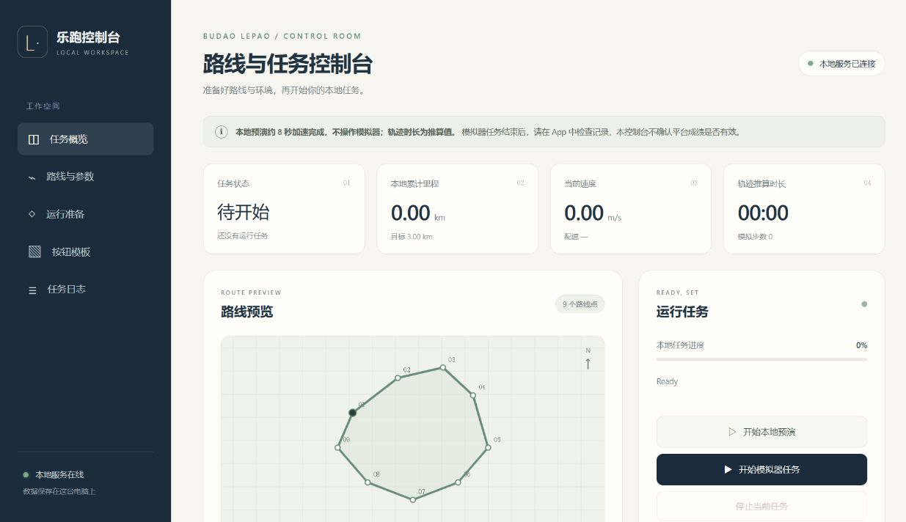

# 完整使用说明：从安装到网页与 MCP

本文按 **Windows + MuMu** 的实际实现说明安装、配置、本地预演和模拟器任务。第一次使用建议先完成本地预演，再准备模拟器。

当前网页和 MCP 功能位于 `fix/runner-validation-and-results` 分支；[PR #4](https://github.com/vibe-GIF/budaolepao/pull/4) 合并前，上游 `main` 可能没有本文的全部功能。请按下文下载完整功能分支，不要只下载一个 Python 文件。

本项目没有实现自动登录、通用校园跑流程、随机打卡点、人脸核验或官方成绩核验。模拟器任务的使用范围见[模拟器说明](../poc/emulator_run/README.md)；本地任务完成不代表平台成绩有效。

阅读顺序：[安装](#1-安装前准备) → [下载源码](#2-下载并安装项目) → [打开网页](#3-启动网页控制台) → [本地预演](#4-配置路线并完成本地预演) → [MuMu](#5-配置-mumu-与-app) → [模板](#6-准备五张按钮模板) → [运行](#7-启动停止与判断结果)。MCP、命令速查和排错在后半部分。

## 1. 安装前准备

| 软件 | 要求与安装来源 |
| --- | --- |
| Windows | 模拟器模式要求 Windows；当前主方案是 MuMu |
| Git | 从 [Git for Windows 官方安装页](https://git-scm.com/install/windows) 安装，用于获取完整源码与更新 |
| Python | Python 3.10 或以上，从 [Python Windows 下载页](https://www.python.org/downloads/windows/) 安装 |
| MuMu | 从网易 MuMu 官方渠道安装 Windows 版；所用版本须提供 `MuMuManager.exe` 和 `adb.exe` |
| 浏览器 | 用于打开本机网页控制台；不需要 Node.js、前端构建或地图 API 密钥 |

安装完成后重新打开 **PowerShell**，检查：

```powershell
git --version
python --version
```

`python --version` 应显示 3.10 或更高版本。找不到命令时，检查安装选项/PATH 并重新打开终端；如果电脑使用 `py` 启动器，可以先用 `py --version` 检查，再用 `py -m venv .venv` 创建下文的虚拟环境。

## 2. 下载并安装项目

在准备存放项目的目录中打开 PowerShell，执行：

```powershell
git clone https://github.com/fanxing1936/budaolepao.git
cd budaolepao
git switch fix/runner-validation-and-results
git branch --show-current
```

最后一行应显示 `fix/runner-validation-and-results`。已有同名目录时，请选择新目录，避免覆盖自己修改的文件。只想用 ZIP 的用户应先在 GitHub 切到该分支再下载完整 ZIP；ZIP 目录不能执行后文的 Git 更新命令。

在包含 `pyproject.toml` 的**仓库根目录**执行：

```powershell
python -m venv .venv
.\.venv\Scripts\python.exe -m pip install -e ".[test,mcp]"
.\.venv\Scripts\python.exe -m pip check
.\.venv\Scripts\lepao.exe -h
```

这里同时安装测试和 MCP 可选依赖。`-e` 表示从当前完整源码运行；项目会读取源码树中的 `poc/`、`detection/`、`eval/`，安装后不要移动或删除源码目录。

本文直接使用 `.venv` 中的程序，不需要执行激活脚本，也不需要修改 PowerShell 执行策略。下文的命令均在仓库根目录运行；如果 `lepao` 未加入 PATH，就使用完整的 `.\.venv\Scripts\lepao.exe`。

## 3. 启动网页控制台

```powershell
.\.venv\Scripts\lepao.exe web
```

保留这个终端，在浏览器打开 **[http://127.0.0.1:8765](http://127.0.0.1:8765)**。页面显示“路线与任务控制台”，连接状态正常即表示网页已连上本地服务。



端口被其他程序使用时，可关闭本项目的旧服务后改用：

```powershell
.\.venv\Scripts\lepao.exe web --port 8766
```

此时打开 `http://127.0.0.1:8766`。服务只监听本机，不是可供手机或他人访问的远程网站。关闭网页标签不会停止任务；退出前先停止任务，再在服务终端按 **Ctrl+C**。

也可运行 `.\.venv\Scripts\lepao.exe` 打开终端菜单，第 **10** 项是网页控制台。第一次使用以网页为主即可。

## 4. 配置路线并完成本地预演

在“路线与参数”中查看配置来源。没有个人 `config.json` 时，网页显示示例配置；保存后才生成个人文件。

| 页面项目 / 配置字段 | 填写要求 |
| --- | --- |
| 路线坐标 / `walk_path` | 每行 `经度,纬度`，至少 3 个不同点；自动闭合，末尾不要重复首点 |
| 目标里程 / `dist_limit_m` | 有限正数，单位是**米**；例如 `1000` 表示 1 km |
| 最低、最高速度 / `min_speed_mps`、`max_speed_mps` | 单位 **m/s**，不是 min/km；两个值均为正数，下限不大于上限，相等表示恒速 |
| 模拟器实例编号 / `instance_index` | 非负整数，默认 `0`；准备模拟器时再核对 |
| 自动操作开始与结束按钮 / `auto_start_run` | 默认开启；需要五张匹配当前界面的模板 |
| 允许固定坐标兜底 / `allow_coordinate_fallback` | 默认关闭；只有界面位置已校准时才适用，不是通用的模板修复方式 |

路线输入格式示例如下，仅用于理解格式，不代表任何学校的有效路线：

```text
114.4050,30.4695
114.4065,30.4705
114.4080,30.4708
```

经度范围为 `[-180,180]`，纬度为 `(-90,90)`；相邻点不能相同，也不支持跨越 ±180° 经线的线段。网页路线图是本地坐标示意图，不含真实道路、围栏或校内任务要求。

点击“保存路线与参数”，确认保存成功，再点击“开始本地预演”。也可以直接开始：存在草稿时页面会先尝试保存；保存失败时不会启动任务。

**本地预演约 8 秒加速完成**，不启动 MuMu、不连接 App、不上传记录。界面“轨迹推算时长”由配置速度和距离计算，不是这次预演在电脑上实际等待的秒数。用它检查路线、进度、日志和停止按钮即可。

没有安装 MuMu或模板不完整时，准备检查可能显示未通过，但有效配置仍可进行本地预演。预演结束后应看到“本地任务结束”及相应日志。

配置保存到 `poc/emulator_run/config.json`。高级字段沿用已读入的配置；不认识的字段、非法数字或错误格式会被拒绝，不会静默换成默认路线。

## 5. 配置 MuMu 与 App

### 5.1 找到两个路径

在文件资源管理器中找到 MuMu 安装目录，并核对文件是否真实存在。在网页“MuMu 运行环境”填写：

| 输入框 | 应填内容 |
| --- | --- |
| MuMu 工具目录 | **同时包含** `MuMuManager.exe`、`adb.exe` 的文件夹，不填某个 `.exe` 文件 |
| 模拟器程序路径 | MuMu 启动程序的**完整文件路径**，包括 `.exe` 文件名，不填文件夹或快捷方式 |

当前支持的启动程序名为 `MuMuPlayer.exe`、`MuMuPlayer-12.0.exe`、`GameViewer.exe`、`GameViewerLauncher.exe`。不同版本和安装位置不相同，不要直接照抄他人的盘符。

点击“保存路径”，项目会写入 `poc/emulator_run/emu_path.json`，字段名为 `emu_dir`、`player_path`。也可用 `lepao scan` 尝试扫描，但扫描主要覆盖常见 NetEase 安装目录，找不到时仍需手动填写。

### 5.2 确认实例编号

默认编号是 `0`，应对应你准备使用的那一个 MuMu 实例。请在 MuMu 多开管理器中核对编号和实例名称，不要把“当前排在第一行”直接当成编号 0。

还可以在 PowerShell 使用管理器的只读信息命令，路径替换为自己的实际路径：

```powershell
& 'D:\实际安装目录\MuMuManager.exe' info -v 0
```

将返回的信息与目标实例核对；使用其他编号时，同时修改网页中的“模拟器实例编号”并保存。运行器连接与位置操作使用这个编号。采集模板的命令有固定 ADB 端口限制，见下文。

### 5.3 准备 App

手动启动目标实例，在该实例中通过你有权使用的来源安装测试 App，完成登录、必要权限和界面提示。仓库不提供已经验证的 App 安装包，也不会替你登录或处理人工核验。

当前默认包名 `run_pkg` 是 `com.lptiyu.tanke`，启动 Activity 固定为 `.activities.splash.SplashActivity`。网页没有包名输入框；如测试版本不同，需要先核对代码兼容性，仅修改包名并不能保证启动。

自动按钮顺序固定为“开始乐跑 → 自由跑确认 → 暂停 → 结束 → 确认结束”。如果你的 App 页面或任务流程不同，先停止准备，核对流程后再调整实现。

## 6. 准备五张按钮模板

仓库当前缺少 **`free_run.png`**。另外四张已带图片也可能与当前 App、主题、分辨率不匹配；有文件不等于能正确识别按钮。

| 界面按钮 | 文件名 | 配置字段 |
| --- | --- | --- |
| 开始乐跑 | `begin_run.png` | `tpl_begin` |
| 自由跑确认 | `free_run.png` | `tpl_free` |
| 暂停，执行时长按 | `pause_run.png` | `tpl_pause` |
| 结束 | `end_run.png` | `tpl_end` |
| 确认结束 | `confirm_end.png` | `tpl_confirm_end` |

模板目录为 `poc/emulator_run/img/`。网页和 MCP 使用表中的固定文件名，不要修改成任意模板路径。

### 6.1 用命令采集

先保存第 5 节的 MuMu 路径，确保 `emu_path.json` 已生成，并让 MuMu 正常运行。在**没有本工具运行任务**时操作：

1. 手动把目标 App 切换到要采集的按钮界面；每张模板都应来自对应的真实界面。
2. 在第二个 PowerShell 窗口进入仓库根目录，执行 `.\.venv\Scripts\lepao.exe capture`。
3. 在弹出的截图窗口拖动鼠标框选按钮区域，按 **空格**确认；不采集时可按 Esc 取消选区。
4. 回到终端，在 `Save as` 提示后输入表中的文件名，例如 `free_run.png`，不要输入完整路径。
5. 看见保存提示后，图片已写入 `poc/emulator_run/img/`；切换到下一个界面，再执行一次命令。

`capture` **每次只获取一张当前截图、保存一个选区**，不会自动导航，也不会一次生成五张图。采集时保持与之后运行相同的模拟器分辨率和界面显示设置，框选实际按钮，避免包含无关大块画面。

当前采集命令依次尝试 `127.0.0.1:16384`、`:7555`、`:7556`，不使用配置中的 `instance_index`。多开时先确认实际连接的是目标实例；如果端口不匹配，可改用手动截图裁剪后的 PNG 上传，不要把错误实例的按钮图当成目标模板。

### 6.2 用网页上传或检查

也可以使用自己已裁剪好的 PNG。在网页“按钮模板”中找到对应按钮卡片，选择图片上传；每张文件不超过 **2 MiB**，单边不超过 4096 像素且总像素不超过 800 万。

上传后卡片应显示可读取状态与图片预览，五张齐全时显示 `5 / 5 已准备`。通过 `capture` 在网页外写入图片后，可刷新页面重新读取；先保存网页上尚未保存的参数草稿。

## 7. 启动、停止与判断结果

1. 保存路线、参数和 MuMu 路径，确认目标 App 已完成必要的人工准备。
2. 在“准备检查”点击“重新检查”，处理每个未通过项。
3. 点击“开始模拟器任务”，查看任务日志和 MuMu 中实际发生的操作。
4. 需要中断时点击“停止当前任务”，等待状态变为 `stopped`，随后检查 App 状态。

准备检查只检查配置、Windows 环境、可执行文件、模板可读性和任务空闲状态；**通过不代表 ADB 已连接、App 已登录、模板实际匹配或平台已接受记录**。实际连接与按钮操作发生在任务启动后，失败会停止并记录错误。

| 状态 | 页面含义与下一步 |
| --- | --- |
| `idle` | 待开始，没有当前任务 |
| `running` | 进行中，可查看进度或请求停止 |
| `stopping` | 正在停止，等待子进程退出，不要反复启动新任务 |
| `stopped` | 本工具已停止；手动检查 App，必要时结束 App 内的活动 |
| `completed` | 本地任务结束；模拟器模式下仍须在 App 中检查结果 |
| `failed` | 任务异常；查看日志中的配置、连接、启动、模板或定位错误 |

距离、速度、步数来自本地计算；`platform_accepted` 为 `null`，没有官方成绩确认。模拟器任务完成或停止后保留 MuMu 窗口，不保证 App 已结束活动。服务重启不会恢复上次任务与内存日志，日志只保留最近的有限条目。

网页与 MCP 使用同一个控制器，同一时间只能运行一个任务，任务期间不能通过它们修改配置、路径或模板。旧命令 `lepao run` 直接运行 PoC，**不受网页任务管理器统一管理**；不要与网页/MCP 同时启动，也不要在运行中用其他命令改配置。

### 配置冲突与恢复

网页和 MCP 同时编辑时，配置版本 `revision` 可防止旧草稿覆盖新保存的配置。出现 `409` 或“配置已变化”提示时，先保留需要的修改，重新读取已保存配置，再合并修改后保存；不要直接反复点保存。

网页“重新读取已保存配置”会将文件内容载入表单；“载入示例草稿”用于从示例重新编辑。已有未保存草稿时会要求确认替换。**载入草稿本身不写文件**，检查后点击保存才会替换个人配置。配置损坏时可先备份原文件，再显式载入示例草稿修复。

## 8. 连接 MCP 客户端

MCP 是网页控制服务的另一种操作入口。先安装 `.[mcp]` 可选依赖（按第 2 节已安装则跳过），并保持 `lepao web` 运行。

在支持 stdio 的 MCP 客户端中添加以下通用配置，把 `command` 改成自己项目 `.venv` 中 Python 的**绝对路径**；JSON 的反斜杠需要双写：

```json
{
  "mcpServers": {
    "lepao": {
      "command": "C:\\projects\\budaolepao\\.venv\\Scripts\\python.exe",
      "args": ["-m", "budaolepao_cli.mcp_server"]
    }
  }
}
```

保存后按客户端的方式重新加载 MCP 服务。不同客户端配置入口可能不同，但启动命令相同。无需在客户端配置中填写 token、HTTP 地址或请求头；桥接器自动读取本源码目录下 `.lepao/controller.json`，换端口或重启网页后会重新发现服务。`.lepao/` 不要提交或共享，也不要把发现文件内容复制到聊天中。

`lepao mcp` / `lepao-mcp` 是相同的 stdio 入口，直接在终端启动可能等待协议输入，没有普通提示并不说明卡死。

### 11 个工具

| 工具 | 参数与用途 |
| --- | --- |
| `get_status` | 无参数；读取状态、模式、进度和退出信息 |
| `read_config` | 无参数；返回完整 `config`、来源及 `revision` |
| `update_config` | `config`、可选 `expected_revision`；保存完整配置，不是只传差异字段 |
| `check_readiness` | 无参数；运行准备检查，不启动设备 |
| `get_logs` | `after=0`；读取日志，下一次使用返回的 `cursor` |
| `start_run` | `mode="preview"` 为默认；`"emulator"` 才操作 MuMu |
| `stop_run` | 无参数；停止本控制器的任务，保留 MuMu |
| `get_emulator` | 无参数；读取 MuMu 路径 |
| `set_emulator` | `emu_dir`、`player_path`；保存本机路径，不启动 MuMu |
| `list_templates` | 无参数；读取五张模板存在/可读状态 |
| `upload_template` | `name`、`content_base64`；上传允许名称的 PNG，最大 2 MiB |

典型只读检查与预演调用顺序如下，`name` / `arguments` 表示工具名与参数，按客户端的调用方式使用：

```json
[
  {"name": "read_config", "arguments": {}},
  {"name": "check_readiness", "arguments": {}},
  {"name": "start_run", "arguments": {"mode": "preview"}},
  {"name": "get_status", "arguments": {}},
  {"name": "get_logs", "arguments": {"after": 0}}
]
```

修改配置时先 `read_config`，在返回的完整 `config` 上修改需要的字段，再把同次读取的 `revision` 传给 `update_config.expected_revision`。遇到 409 时重新读取并合并；省略版本字段不会执行冲突保护。预演无误且设备准备完成后，才明确调用 `start_run` 的 `emulator` 模式。

`get_logs` 的后续 `after` 使用上次响应的 `cursor`，而不是固定填 0。需要停止时调用 `stop_run`。`upload_template.content_base64` 是 PNG 文件字节的 base64，不带 `data:image/png;base64,` 前缀。

工具失败会返回 `error`，应先检查它再读取业务字段；不会自动启动网页服务或自动重试写入。停止 MCP 客户端不会关闭网页服务。更多接口细节见 [MCP 说明](mcp.md)。

## 9. CLI 速查与测试

下表的 `lepao` 均可替换成 `.\.venv\Scripts\lepao.exe`；使用网页/MCP 时不需要逐项运行这些命令。

| 命令 | 作用 |
| --- | --- |
| `lepao` / `lepao panel` | 终端控制菜单，输入 `q` 退出 |
| `lepao -h` | 查看主入口帮助 |
| `lepao web --port 8765` | 本机网页服务；`lepao web --help` 查看参数 |
| `lepao mcp` | stdio MCP；可用 `--controller-file` 指定另一份本地发现文件 |
| `lepao config show` | 显示个人 `config.json`；尚未保存时会提示文件不存在 |
| `lepao config set --speed 3-4 --distance 1000` | 保存速度范围与米数；示例数值仅说明命令格式 |
| `lepao config route 经度,纬度 经度,纬度 经度,纬度` | 保存路线，替换成至少 3 组真实测试坐标 |
| `lepao config map` | 另一个坐标拾取入口，会使用外部地图页面；网页内的示意图不依赖它 |
| `lepao scan` / `lepao capture` | 尝试扫描 MuMu / 采集单张按钮模板 |
| `lepao run` | 直接运行模拟器 PoC，先完成准备，勿与控制器任务并行 |
| `lepao detect` | 独立本地检测服务，地址 `http://127.0.0.1:8000` |
| `lepao dashboard --demo` / `lepao eval` | 检测演示看板 / 本地评估，不证明官方平台检测结果 |
| `lepao setup` | 从当前源码重新 editable 安装基础依赖；额外依赖仍用 pip 的 extras 安装 |

运行离线测试：

```powershell
.\.venv\Scripts\python.exe -m pip install -e ".[test,mcp]"
.\.venv\Scripts\python.exe -m pytest -q
.\.venv\Scripts\python.exe -m pip check
```

只检查 MCP 可运行 `.\.venv\Scripts\python.exe -m pytest tests/test_mcp.py -q`。未安装可选 `mcp` 依赖时该测试文件会跳过，不能把跳过当成 MCP 已验证。测试使用本地数据、假的设备/HTTP 控制器以及 SDK 协议，不启动真实 MuMu、不登录账号、不上传跑步记录。

## 10. 常见问题

| 现象 | 处理方法 |
| --- | --- |
| 没有 `web` 命令或找不到模块 | 核对分支、当前目录及 `.venv` 路径，再执行第 2 节 editable 安装；不要使用另一套环境的全局 `lepao` |
| 网页打不开 | 查看服务终端是否仍在运行、端口是否与地址一致；使用 `127.0.0.1`，不是 `0.0.0.0` |
| 端口占用 | 确认是否已有本项目服务；不需要它时正常退出，否则改用 `--port 8766`；同一源码目录仍只启动一个控制服务 |
| 提示发现文件已存在 | 先确认旧服务是否仍运行，按下方步骤处理残留文件；不要在旧服务运行时删除 |
| 配置无效或 409 冲突 | 查看具体字段，备份后重新读取/载入示例草稿；冲突时合并最新配置，不强行覆盖 |
| MuMu 文件不存在 | 工具目录须同时有两个 EXE，程序路径须是受支持启动程序的完整路径；快捷方式不算 |
| ADB 连接超时或连错实例 | 手动确认目标实例已开机和编号正确；采集命令只尝试三个固定端口，运行器则从管理器读取指定实例的连接信息 |
| 缺少 `free_run.png` / 模板识别失败 | 在当前版本和分辨率下重新采集对应按钮，确认截图内容；可读性通过不保证匹配，别用无关 PNG 填满数量 |
| App 未安装或启动失败 | 确认安装在指定实例；核对 `run_pkg` 和固定 SplashActivity 是否与该版本一致，路径正确不能解决 Activity 不兼容 |
| MCP 服务未连接 | 先启动同一源码目录的 `lepao web`，确认客户端使用正确 `.venv` 的绝对 Python 路径；安装 `.[mcp]` 后重新加载客户端 |
| MCP 认证失败 / 服务不可达 | 检查网页服务进程；必要时正常停止后重启，以刷新发现信息，不手动复制或填写 token |
| 任务已停止但 App 仍在运行 | 停止的是本工具任务，进入 MuMu 检查并手动结束 App 内活动 |

异常退出可能留下 `.lepao/controller.json`。先查看任务管理器/原终端，确认旧控制服务已退出；可只读取 PID 辅助核对，不输出整个发现文件：

```powershell
$controllerPid = (Get-Content .\.lepao\controller.json -Raw | ConvertFrom-Json).pid
Get-Process -Id $controllerPid -ErrorAction SilentlyContinue
```

PID 也可能已被其他程序使用，应核对对应进程，不能据此随意结束它。**确认旧服务已退出后**，只移除残留发现文件，再启动网页：

```powershell
Remove-Item -LiteralPath .\.lepao\controller.json
.\.venv\Scripts\lepao.exe web
```

## 11. 更新、目录与完成判断

更新前停止任务和服务，把 `poc/emulator_run/config.json`、`poc/emulator_run/emu_path.json`、`poc/emulator_run/img/` 复制到仓库外的备份目录。配置和路径已忽略，但部分模板是 Git 跟踪文件，采集/上传后会产生本地修改。

先查看状态并获取远端改动，不直接用更新操作覆盖本地修改：

```powershell
git status --short
git fetch origin
git diff --stat HEAD..origin/fix/runner-validation-and-results
```

工作区干净、确认变更后，可用 `git merge --ff-only origin/fix/runner-validation-and-results` 快进更新；有本地修改或分支分叉时先处理差异。新手也可在新目录 clone 最新分支，重新安装依赖后按字段迁移个人配置与模板，保留旧目录用于对照。不要用强制重置来“解决”未备份的修改。

```text
budaolepao/
├─ pyproject.toml              安装依赖、入口和测试设置
├─ budaolepao_cli/             CLI、网页、共享控制器、MCP、任务进程及 static/
├─ poc/emulator_run/
│  ├─ config.example.json     示例配置
│  ├─ config.json             保存后生成的个人运行配置
│  ├─ emu_path.json           保存后的本机 MuMu 路径
│  └─ img/                    五张按钮模板
├─ .lepao/                    本机服务发现文件与临时任务配置，不共享
├─ detection/、eval/          独立检测与本地评估
└─ tests/、docs/              测试与使用说明
```

更新后重新安装依赖、运行测试、重启网页及 MCP，并复查模板。可以按三层判断进度：**网页可连接并完成预演**表示本地控制流程可用；**准备检查通过**表示静态准备项满足要求；**真实模拟器任务完成**仍只表示本地运行器结束，必须另行检查 App 实际状态，不能推断成绩有效。

[控制台专题](control-center.md)与 [MCP 专题](mcp.md)提供更细的接口说明。[Android 容器后端](android-container-idea.md)仅为后续设想，尚未实现；当前没有容器安装或运行命令，主方案继续使用 MuMu。
